# Architecture du Data Warehouse — Électricité & Gaz (Modèle en Constellation)

Ce document décrit le modèle en étoile / constellation de faits conçu pour analyser et visualiser les **facteurs d'influence ("influencers") de la consommation d'énergie** (électricité principalement, et gaz naturel) à la maille régionale depuis 2020.

---

## 1. Schéma Relationnel (Mermaid `erDiagram`)

```mermaid
erDiagram
    dim_territoire ||--o{ dim_contexte_territoire_annuel : "possède un contexte annuel"
    dim_territoire ||--o{ fait_conso_annuelle : "mesurée dans"
    dim_territoire ||--o{ fait_conso_segmentee_inf36 : "mesurée dans"
    dim_territoire ||--o{ fait_conso_journaliere_elec : "mesurée dans"

    dim_calendrier ||--o{ fait_conso_annuelle : "année"
    dim_calendrier ||--o{ fait_conso_segmentee_inf36 : "mois / année"
    dim_calendrier ||--o{ fait_conso_journaliere_elec : "date_jour"

    dim_energie ||--o{ fait_conso_annuelle : "commute"
    dim_energie ||--o{ fait_conso_segmentee_inf36 : "Electricité"
    dim_energie ||--o{ fait_conso_journaliere_elec : "Electricité"

    dim_tarif_reglemente ||--o{ fait_conso_segmentee_inf36 : "croise (option, kVA)"
    dim_contexte_territoire_annuel ||--o{ fait_conso_annuelle : "influence (code_geo, annee)"

    dim_territoire {
        string code_geo PK "Code INSEE Région (11, 24, 84...)"
        string nom_region "Libellé officiel (Île-de-France...)"
        string zone_vacances "Zone A / Zone B / Zone C / Corse"
    }

    dim_energie {
        string id_energie PK "ELEC / GAZ"
        string code_filiere "Electricité / Gaz (jointure REG_conso)"
        string libelle_energie "Électricité / Gaz naturel"
        string unite_mesure "MWh"
    }

    fait_conso_journaliere_elec {
        date date_jour FK "Clé vers dim_calendrier (YYYY-MM-DD)"
        string code_geo FK "Clé vers dim_territoire (code_insee_region)"
        string id_energie FK "Toujours ELEC"
        float conso_totale_mwh "Énergie totale du jour (MWh)"
        float puissance_moyenne_mw "Puissance moyenne journalière (MW)"
        float pic_journalier_mw "Pointe de consommation du jour (MW)"
    }

    dim_contexte_territoire_annuel {
        string code_geo PK, FK "Code INSEE Région"
        int annee PK "Année (2020..2025)"
        float dju_tr "DJU à Température Réelle"
        float dju_tn "DJU à Température Normale"
        float thermosensibilite_moy_kwh_dju "kWh par DJU"
        float taux_chauffage_electrique "Part chauffage élec (0 à 1)"
        float taux_logements_collectifs "Part collectif (0 à 1)"
        float taux_residences_principales "Part rés. principales (0 à 1)"
        int nombre_d_habitants "Population régionale"
        float superficie_moins_30m2 "Nb logements < 30 m2"
        float superficie_30_40m2 "Nb logements 30 à 40 m2"
        float superficie_40_60m2 "Nb logements 40 à 60 m2"
        float superficie_60_80m2 "Nb logements 60 à 80 m2"
        float superficie_80_100m2 "Nb logements 80 à 100 m2"
        float superficie_plus_100m2 "Nb logements > 100 m2"
        float residences_avant_1919 "Nb rés. avant 1919"
        float residences_1919_1945 "Nb rés. 1919-1945"
        float residences_1946_1970 "Nb rés. 1946-1970"
        float residences_1971_1990 "Nb rés. 1971-1990"
        float residences_1991_2005 "Nb rés. 1991-2005"
        float residences_2006_2018 "Nb rés. 2006-2018"
        float residences_apres_2019 "Nb rés. après 2019"
    }

    dim_calendrier {
        date date_jour PK "YYYY-MM-DD"
        int annee "YYYY"
        string periode_mois "YYYY-MM"
        int mois "1..12"
        int jour_semaine "1..7 (Lundi..Dimanche)"
        boolean est_weekend "True si Samedi/Dimanche"
        string saison "Hiver / Printemps / Été / Automne"
        boolean est_jour_ferie "Via bibliothèque Python holidays"
        string nom_jour_ferie "Nom du jour férié"
        boolean vacances_zone_a "Extrait de Zone-A-B-C-Corse.ics"
        boolean vacances_zone_b "Extrait de Zone-A-B-C-Corse.ics"
        boolean vacances_zone_c "Extrait de Zone-A-B-C-Corse.ics"
        boolean vacances_corse "Extrait de Zone-A-B-C-Corse.ics"
    }

    dim_tarif_reglemente {
        string id_tarif PK "Clé technique (Option + kVA + Date)"
        string option_tarifaire "BASE / HPHC / TEMPO"
        int p_souscrite_kva "3, 6, 9, 12, 15, 18, 24, 30, 36"
        date date_debut "Date d'entrée en vigueur"
        date date_fin "Date de fin de validité"
        float part_fixe_ttc "Abonnement annuel (€/an TTC)"
        float part_variable_ttc_base "Prix kWh Base (€/kWh TTC)"
        float part_variable_ttc_hp "Prix kWh Heures Pleines (€/kWh TTC)"
        float part_variable_ttc_hc "Prix kWh Heures Creuses (€/kWh TTC)"
        float part_variable_bleu_hp "Tempo Bleu HP (€/kWh TTC)"
        float part_variable_bleu_hc "Tempo Bleu HC (€/kWh TTC)"
        float part_variable_blanc_hp "Tempo Blanc HP (€/kWh TTC)"
        float part_variable_blanc_hc "Tempo Blanc HC (€/kWh TTC)"
        float part_variable_rouge_hp "Tempo Rouge HP (€/kWh TTC)"
        float part_variable_rouge_hc "Tempo Rouge HC (€/kWh TTC)"
    }

    fait_conso_segmentee_inf36 {
        string periode FK "YYYY-MM (ou YYYY)"
        string code_geo FK "Code INSEE Région"
        string id_energie FK "Toujours ELEC"
        string categorie_client "RES / PRO"
        string option_tarifaire "BASE / HPHC"
        string profil_enedis "RES1, RES11, RES2, PRO1..."
        int p_souscrite_kva "Puissance souscrite (kVA)"
        float conso_totale_mwh "Volume total soutiré (MWh)"
        int nb_points_soutirage_moyen "Nombre moyen de compteurs (PDL)"
        float conso_moyenne_par_site_mwh "Conso par compteur (MWh/site)"
    }

    fait_conso_annuelle {
        int annee FK "YYYY"
        string code_geo FK "Code INSEE Région"
        string id_energie FK "ELEC / GAZ"
        string categorie_consommation "RES / ENT_PRO / ENT"
        string grand_secteur "RESIDENTIEL / TERTIAIRE / INDUSTRIE / AGRICULTURE"
        float conso_totale_mwh "Consommation totale (MWh)"
        float conso_moyenne_mwh "Consommation moyenne par site (MWh)"
        int nb_sites "Nombre de points de livraison"
        float part_thermosensible "Part thermosensible (0 à 1)"
        float conso_usages_thermosensibles_mwh "MWh thermosensibles"
        float conso_usages_non_thermosensibles_mwh "MWh non thermosensibles"
        float conso_corrigee_alea_climatique_mwh "MWh corrigés du climat (à DJU normal)"
    }
```

---

## 2. Sources d'Alimentation (`brainstorm-data/`)

| Table | Type | Fichier(s) / Source d'alimentation |
| :--- | :---: | :--- |
| **`fait_conso_annuelle`** | Fait | `brainstorm-data/REG_conso_ajd.csv` (mis à jour via `fetch_reg_conso.py`) |
| **`fait_conso_segmentee_inf36`** | Fait | `brainstorm-data/conso-inf36-region-agg.csv` (agrégé via `fetch_enedis_conso_inf36.py`) |
| **`fait_conso_journaliere_elec`** | Fait | `brainstorm-data/eco2mix-regional-tr.csv` (exporté depuis l'API ODRÉ Opendatasoft) |
| **`dim_contexte_territoire_annuel`** | Dimension | Colonnes climatiques (`DJU à TR`, `DJU à TN`) et logements de `brainstorm-data/REG_conso_ajd.csv` dédoublonnées par `(code_geo, annee)` |
| **`dim_territoire`** | Dimension | Codes INSEE et noms des 13 régions métropolitaines + correspondance zones académiques (`Zone A`, `Zone B`, `Zone C`, `Corse`) |
| **`dim_energie`** | Dimension | Table de référence (`ELEC` = Électricité, `GAZ` = Gaz naturel) |
| **`dim_calendrier`** | Dimension | Calendrier généré en Python enrichi avec `brainstorm-data/vacances-scolaires/Zone-A-B-C-Corse.ics` et la librairie Python `holidays` |
| **`dim_tarif_reglemente`** | Dimension | `brainstorm-data/tarifs-elec/Option_Base.csv`, `Option_HPHC.csv` et `Option_Tempo.csv` |

---

## 3. Questions Métier auxquelles le Data Warehouse permet de répondre

### 💰 A. Options Tarifaires & Sensibilité aux Prix (`fait_conso_segmentee_inf36` $\times$ `dim_tarif_reglemente`)

1. **Qui consomme le plus d'électricité : l'option `BASE` ou l'option `Heures Pleines / Heures Creuses (HPHC)` ?**
   * **En volume total (MWh)** : Quelle part de la consommation résidentielle et petits professionnels ($\le 36\text{ kVA}$) provient des contrats `BASE` vs `HPHC` ?
   * **En consommation moyenne par compteur (`conso_moyenne_par_site_mwh`)** : Un foyer abonné en `HPHC` consomme-t-il en moyenne deux fois plus qu'un foyer en `BASE` (effet ballon d'eau chaude électrique, chauffage électrique, véhicule électrique) ?
2. **Comment la répartition des puissances souscrites (`3, 6, 9, 12... kVA`) diffère-t-elle entre `BASE` et `HPHC` ?**
   * Les petits compteurs (`3 kVA` et `6 kVA`) privilégient-ils massivement l'option `BASE`, tandis que les puissances $\ge 9\text{ kVA}$ basculent en `HPHC` ?
3. **Quel est l'impact des hausses des Tarifs Réglementés de Vente (TRV) sur les comportements de consommation et d'abonnement ?**
   * Observe-t-on une baisse de la consommation moyenne par site ou une migration du nombre de compteurs (`nb_points_soutirage_moyen`) entre options lors des fortes revalorisations tarifaires de 2022–2024 ?
   * Comment évolue l'écart de rentabilité théorique entre `Option_Base`, `Option_HPHC` et `Option_Tempo` ?

---

### 🌡️ B. Climat, Température & Thermosensibilité (`fait_conso_annuelle` $\times$ `dim_contexte_territoire_annuel`)

4. **Quelle part de la variation annuelle de consommation est due à la météo (hiver doux vs hiver rigoureux) par rapport aux efforts réels de sobriété ?**
   * En comparant la **consommation réelle** (`conso_totale_mwh` soumise aux `dju_tr`) à la **consommation corrigée de l'aléa climatique** (`conso_corrigee_alea_climatique_mwh` ramenée aux `dju_tn`), quelle région a réellement réduit structurellement sa consommation depuis la crise énergétique de 2022 ?
5. **Quelle est la sensibilité au froid (`thermosensibilite_moy_kwh_dju`) de chaque région et de chaque énergie (Électricité vs Gaz) ?**
   * Combien de MWh supplémentaires de gaz et d'électricité sont consommés dans chaque région lorsque l'hiver compte +100 DJU de plus que la normale ?
6. **Quelle est la proportion d'usages thermosensibles (chauffage) vs non thermosensibles (électroménager, cuisson, eau chaude, process industriel) ?**
   * Comment évolue `part_thermosensible` selon le secteur (`RESIDENTIEL` vs `TERTIAIRE`) et la région ?

---

### 🏠 C. Parc de Logements & Équipement Thermique (`fait_conso_annuelle` $\times$ `dim_contexte_territoire_annuel`)

7. **Comment le `taux_chauffage_electrique` d'une région explique-t-il le rapport de force entre consommation d'Électricité et consommation de Gaz naturel ?**
   * Pourquoi certaines régions (ex. régions du Sud-Ouest / Sud-Est ou Bretagne avec fort taux de chauffage électrique) présentent-elles une thermosensibilité électrique élevée, tandis que les régions du Nord/Est (fort réseau gazier) absorbent le froid via le gaz naturel ?
8. **Quel est l'impact de l'âge du parc immobilier (passoires thermiques vs bâtiments récents) sur la consommation moyenne par foyer ?**
   * Les régions ayant une forte proportion de résidences principales construites **avant 1919** ou **entre 1946 et 1970** (avant la première réglementation thermique de 1974) consomment-elles davantage par habitant ou par site à climat équivalent (`dju_tn`) que celles ayant un parc récent (**après 2006 / 2019**) ?
9. **Comment la typologie d'habitat (`taux_logements_collectifs` vs maisons individuelles et taille des logements en $\text{m}^2$) influence-t-elle la consommation par foyer ?**
   * Dans quelle mesure une région très dense en petits appartements collectifs (ex. Île-de-France, forte part de `< 30 m2` et `30 à 60 m2`) consomme-t-elle moins par site résidentiel qu'une région dominée par de grandes maisons individuelles (`> 100 m2`) ?

---

### 📅 D. Rythmes Calendaires : Vacances Scolaires, Jours Fériés & Saisonnalité (`fait_conso_journaliere_elec` $\times$ `dim_calendrier` $\times$ `dim_territoire`)

10. **Quel est l'impact des vacances scolaires (par Zone A, B, C, Corse) sur la consommation électrique quotidienne et la pointe journalière (`pic_journalier_mw`) ?**
    * Lorsqu'une région entre dans sa propre période de vacances d'hiver ou de Noël (via la jointure `dim_territoire.zone_vacances` $\leftrightarrow$ `dim_calendrier.vacances_zone_*`), de combien de % chute la consommation ou le pic journalier (fermeture des écoles et baisse d'activité tertiaire) ?
11. **Quel est le "décrochage" de consommation lors des jours fériés officiels et des week-ends ?**
    * Quelle est la baisse moyenne de consommation un jour férié tombant en semaine par rapport à un jour ouvré normal de la même saison et de la même région ?
12. **Comment se déforme la courbe saisonnière entre l'hiver et l'été selon les régions ?**
    * Quelles régions connaissent un pic estival lié à la climatisation et au tourisme (ex. Provence-Alpes-Côte d'Azur, Occitanie, Corse) comparé au creux estival des régions continentales ?

---

### ⚡🔥 E. Comparaison Multi-Énergies & Sectorielle (`fait_conso_annuelle` $\times$ `dim_energie`)

13. **Comment se répartit le mix de consommation finale entre Électricité et Gaz naturel par grand secteur (`RESIDENTIEL`, `TERTIAIRE`, `INDUSTRIE`, `AGRICULTURE`) ?**
    * Quel secteur pèse le plus dans la consommation de gaz vs d'électricité au sein de chaque région ?
14. **Observe-t-on une électrification des usages au détriment du gaz naturel depuis 2020 ?**
    * La baisse de consommation du gaz résidentiel/tertiaire entre 2020 et 2025 s'accompagne-t-elle d'une hausse du `taux_chauffage_electrique` et du nombre de sites électriques (pompes à chaleur, rénovations) ?
